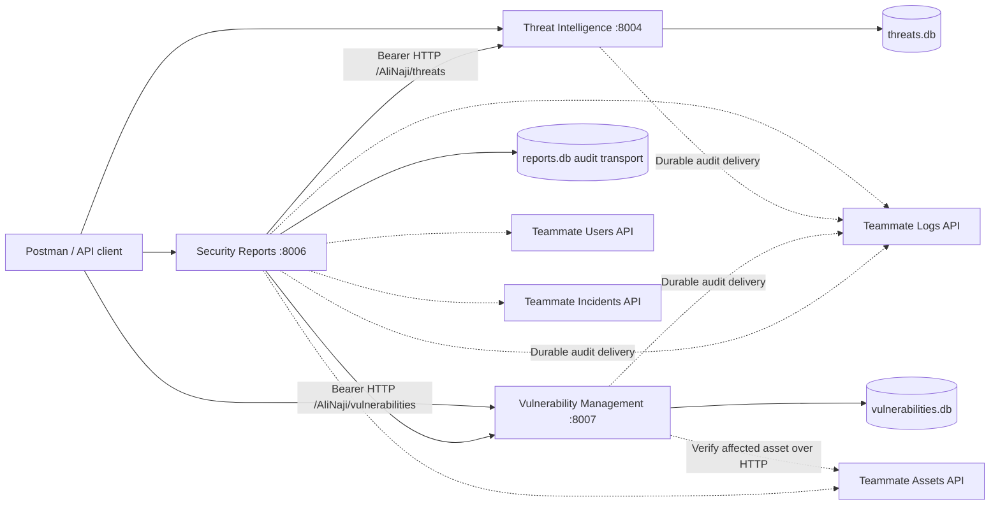

# Service architecture (Ali Naji)

Ali Naji's three FastAPI processes have separate SQLite databases and communicate through authenticated HTTP APIs. Classes separate request validation, permission enforcement, repository transactions, external integration, and reporting calculations. Composition connects the database/repository/audit adapter; Pydantic models and enum classes express shared validation contracts. This keeps the three assigned services independently runnable and gives teammates explicit integration boundaries.

Dashed connections require teammate implementations/configuration. Each service verifies JWT signatures and exact roles before protected operations; optional current-user introspection checks live account status. Every HTTP route includes `/AliNaji`, including health/OpenAPI/documentation. No unnamed aliases or endpoints for the other six services are exposed.

Writes use bound SQL parameters and commit the business change plus audit event atomically. The audit sink is outside the database transaction; failed delivery leaves an immutable event in the outbox for retry. Report reads use the caller's token across all sources and fail if any required source is missing or malformed. An empty available dataset gives zero counts; an unavailable source gives 503. A report is a view gathered across calls, not a globally atomic snapshot.
