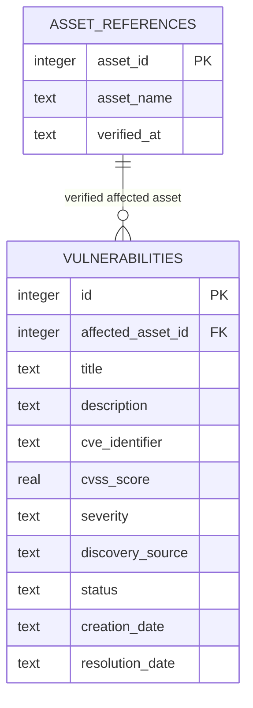
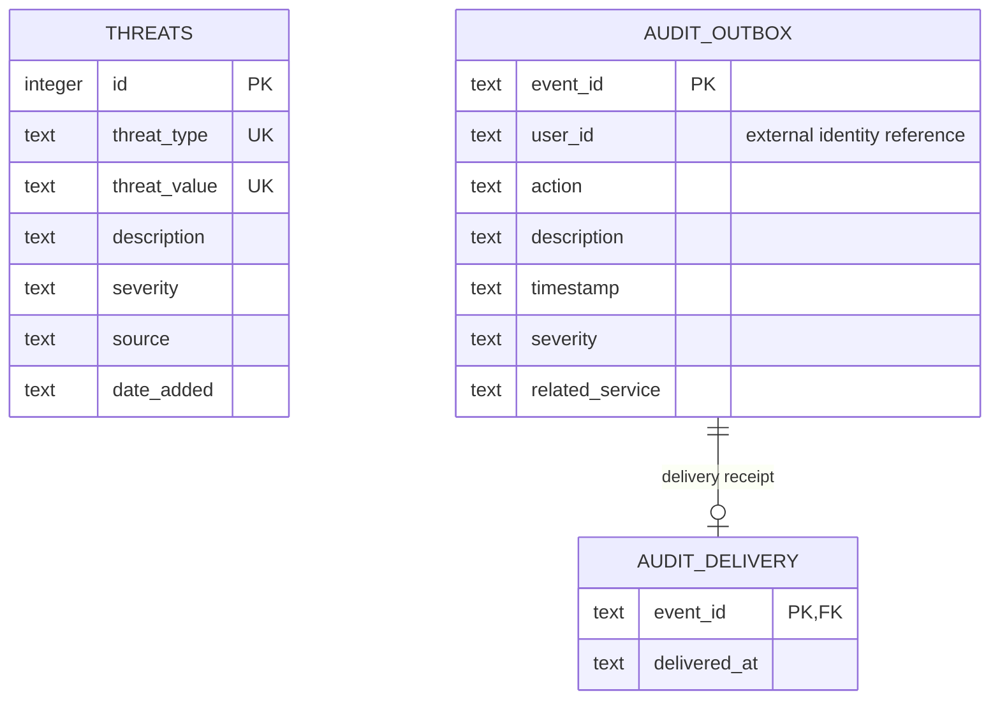

# Database design (Ali Naji)

Each service owns a SQLite file. Every connection enables foreign keys and uses transactions. WAL supports concurrent readers; short writes have a ten-second busy timeout. Parameterized SQL binds all input values. SQL files are idempotent initial schemas; future structural changes need explicit versioned migrations.

## Threat database (Ali Naji)

`data/threats.db`: `threats.id` is an autoincrement integer primary key. `threat_type`, `threat_value`, `description`, `severity`, `source`, and `date_added` contain all required assignment fields. The composite unique key prevents duplicate type/value pairs, including concurrent inserts. CHECK constraints enforce enums and nonempty fields. Type/severity indexes support filtering. Normalization occurs before insertion. No user foreign key is invented because Threats has none in the assignment.

## Vulnerability database (Ali Naji)

`data/vulnerabilities.db`: `vulnerabilities.id` is an autoincrement integer primary key. Fields: title, description, cve_identifier, cvss_score, severity, affected_asset_id, discovery_source, status, creation_date, resolution_date. `affected_asset_id` is a required FK to `asset_references.asset_id` with restricted deletion. One verified asset reference can have multiple vulnerabilities. `asset_references` stores only external id, optional name, and verification timestamp, not a replacement asset catalog. See the integration contract for the distributed relationship to canonical Assets.

Indexes cover CVE, affected asset, severity, and status. CHECK constraints enforce CVSS range, severity/status enums, and consistency of status/resolution date. SQL triggers reject non-Open creation and invalid status transitions. The repository serializes status read/validate/write in a transaction so parallel updates cannot skip steps. Asset reference insertion, vulnerability insertion, and audit event insertion share a transaction.

The Assets API connection is an HTTP verification, not a database FK to an absent teammate table.

## Reports database (Ali Naji)

`data/reports.db` contains `audit_outbox` and `audit_delivery` only. Reports are derived by fetching live records over HTTP and calculating counts in memory. No new business entity/table is required by Service 6 or the assignment's database entity list. No copies of teammates' Users, Assets, Incidents, or Logs tables are created.

The two UK labels on Threats represent one composite unique key on the pair, not separate unique columns. Audit transport tables exist independently in each service database.

## Audit transport tables (Ali Naji)

Each service database also contains `audit_outbox` (UUID primary key and event content) and `audit_delivery` (one delivery receipt per event; foreign key to outbox). Triggers prevent changing/deleting original events. These tables preserve our events until delivery to the teammate's Logs API; they do not expose audit management endpoints. `user_id` is an external identity reference, not a local Users-table foreign key.

Inspect the live database using DB Browser for SQLite or the `sqlite3` Python module after executing APIs. Do not submit empty databases or seeded fixtures as API execution evidence.
