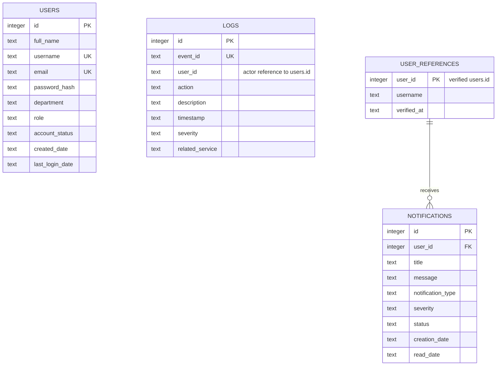

# Users, Audit Logging and Notifications (Mohamed Kassem)

Mohamed Kassem owns Service 1 (Users and Identity Management), Service 5 (Security Audit Logging) and Service 8 (Notification and Alert Management). They follow the same design as the rest of the repository: one FastAPI process and one SQLite database per service, communication over authenticated HTTP, and every route prefixed with the author's name (`/MohamedKassem`).

| Service | Port | Base URL | Database | Interactive docs |
| --- | --- | --- | --- | --- |
| Users and Identity Management | 8001 | `http://127.0.0.1:8001/MohamedKassem` | `data/users.db` | `/MohamedKassem/docs` |
| Security Audit Logging | 8005 | `http://127.0.0.1:8005/MohamedKassem` | `data/logs.db` | `/MohamedKassem/docs` |
| Notification and Alert Management | 8008 | `http://127.0.0.1:8008/MohamedKassem` | `data/notifications.db` | `/MohamedKassem/docs` |

## Run (Mohamed Kassem)

Linux or macOS:

```bash
scripts/setup_local.sh
.venv/bin/python -m scripts.create_admin      # creates admin1, asks for its password
scripts/run.sh users                          # one terminal each: users, logs, notifications
```

Windows PowerShell:

```powershell
.\scripts\setup_local.ps1
.\.venv\Scripts\python.exe -m scripts.create_admin
.\scripts\run.ps1 users
```

Setup writes `JWT_SECRET` and `AUDIT_SERVICE_TOKEN` to the ignored `.env`. Every service loads the same file, so a token returned by login is accepted by all services, and every service delivers its audit events to the Logs service. Restart services after changing `.env`.

The register API only lets an administrator create privileged accounts, so the first administrator comes from `scripts.create_admin`. It uses the same validation, hashing and audit event as the API.

**Postman:** import `postman/MohamedKassem.environment.json` and the three `MohamedKassem.*` collections. Set `admin_password` in the environment, then run **Users**, **Logs**, **Notifications** in that order. The Users collection logs in, registers an analyst, an auditor and two employees, and stores their tokens and ids in the environment for the other two collections. Each run uses a fresh random suffix, so collections can be rerun without cleanup. The same environment tokens also work with Ali Naji's collections.

```bash
.venv/bin/python -m pytest -q
npx --yes newman@6.2.1 run postman/MohamedKassem.users.postman_collection.json -e <your environment> --export-environment <your environment>
```

## Authentication (Mohamed Kassem)

- Passwords are hashed with bcrypt (cost 12, random salt per password). Only `password_hash` is stored and no response contains it. Policy: 8 to 72 bytes with an uppercase letter, a lowercase letter, a digit and a symbol.
- `POST /users/login` accepts either `username` or `email` plus `password` and verifies the bcrypt hash. Success returns a JWT signed with HS256. Claims: `sub` (user id), `role`, `account_status`, `iat`, `exp` (60 minutes), `iss`, `aud`. This is the contract `shared/auth.py` verifies, so all services check tokens locally without calling Users.
- A wrong password returns 401 whatever the account status. A correct password on an Inactive or Suspended account returns 403. Unknown usernames are checked against a dummy hash so response time does not reveal which usernames exist.
- Every protected route uses `require(...)` from `shared/auth.py`: missing, invalid or expired token gives 401, a role outside the route's list gives 403. Ownership rules (own profile, own notifications) use `forbid()`, which also returns 403. Both record the violation in the audit log.

## Users and Identity Management API (Mohamed Kassem)

| API | Method and path | Allowed roles | Success |
| --- | --- | --- | --- |
| User registration | `POST /users/register` | Anyone for Regular Employee/User; Administrator for any role | 201 user |
| User login | `POST /users/login` | Public | 200 token and user |
| Update user information | `PUT /users/{id}` | Administrator (any user); Regular Employee/User (own account) | 200 user |
| Delete user | `DELETE /users/{id}` | Administrator | 204 empty |
| Retrieve all users | `GET /users` | Administrator, Auditor | 200 array |
| Retrieve user by username | `GET /users/{username}` | Administrator, Auditor; Regular Employee/User (own account) | 200 user |

```json
POST /users/register
{"full_name":"Lab Employee","username":"lab_employee","email":"employee@example.com","password":"Lab#Pass2026","department":"Finance","role":"Regular Employee/User"}

201
{"id":4,"full_name":"Lab Employee","username":"lab_employee","email":"employee@example.com","department":"Finance","role":"Regular Employee/User","account_status":"Active","created_date":"2026-10-20T08:09:29.42+00:00","last_login_date":null}
```

```json
POST /users/login
{"username":"lab_employee","password":"Lab#Pass2026"}

200
{"message":"Login successful","access_token":"<JWT>","token_type":"bearer","expires_in":3600,"user":{...}}
```

- **Validation:** all six registration fields are required. Username is 3 to 30 letters, digits or underscores; email must be a valid address and is stored in lowercase; role must be one of the four roles. Unknown fields are rejected. Every invalid field is listed in one 422 response.
- **Duplicates:** username and email have `UNIQUE COLLATE NOCASE` constraints, so `Alice` and `alice` count as the same username even under concurrent requests. A duplicate returns 409 `Username already exists` or `Email is already registered`.
- **Updates:** a user may change their own `full_name`, `email` and `department`. Only an administrator may also change `role` and `account_status`. Each account has one role, so assigning, updating and removing a role assignment are all done by setting `role` (removing means setting it back to Regular Employee/User). A role or account status change is logged as `ROLE_CHANGED` / `USER_UPDATED` and the user receives a System Notification.
- **Lookups:** `GET /users/{username}` takes the username; `PUT` and `DELETE /users/{id}` take the numeric id, as listed in the brief. A regular user who asks for another profile gets 403 whether or not it exists.

## Security Audit Logging API (Mohamed Kassem)

| API | Method and path | Allowed roles | Success |
| --- | --- | --- | --- |
| Create log record | `POST /logs` | Administrator (and the service token) | 201 log |
| Retrieve all logs | `GET /logs` | Administrator, Auditor | 200 array |
| Retrieve specific log | `GET /logs/{id}` | Administrator, Auditor, Analyst | 200 log |
| Search logs | `GET /logs/search` | Administrator, Auditor, Analyst | 200 array |
| Delete logs | `DELETE /logs/{id}` | Administrator | 204 empty |
| Retrieve logs by user | `GET /logs/user/{user_id}` | Administrator, Auditor | 200 array, `[]` when none |

```json
POST /logs
{"user_id":4,"action":"MANUAL_REVIEW","description":"Administrator reviewed the access request","severity":"Information","related_service":"Security Audit Logging"}

201
{"id":12,"user_id":"4","action":"MANUAL_REVIEW","description":"Administrator reviewed the access request","timestamp":"2026-10-20T08:12:01.5+00:00","severity":"Information","related_service":"Security Audit Logging"}
```

- `user_id` must be sent but may be `null` for an unknown actor (for example a failed login for a username that does not exist). Severity is Information, Warning, Error or Critical.
- An optional `timestamp` (with timezone, not in the future) keeps the original event time when another service delivers a queued event. An optional `Idempotency-Key` header makes a retried delivery return the stored record with 200 instead of creating a duplicate.
- Search filters, combined with AND: `user_id`, `date` (UTC day, `YYYY-MM-DD`), `action` and `related_service` (case-insensitive exact match), `severity`. Unknown parameters return 422.
- **Protection:** there is no update route and a database trigger rejects any `UPDATE` on `logs`. Only an administrator can delete a record, and the deletion is itself recorded as `LOG_DELETED`.

### Events recorded automatically (Mohamed Kassem)

| Source | Actions |
| --- | --- |
| Users | `LOGIN_SUCCESS`, `LOGIN_FAILED` (Warning; wrong password, unknown user, or blocked account), `USER_CREATED`, `USER_UPDATED`, `ROLE_CHANGED`, `USER_DELETED` (Warning) |
| Notifications | `NOTIFICATION_CREATED`, `NOTIFICATION_READ`, `NOTIFICATION_DELETED` |
| Logs | `LOG_DELETED` (Warning) |
| Every service | `PERMISSION_DENIED` (Warning), `AUTHENTICATION_FAILED` (Warning) |
| Ali Naji's services | `THREAT_*`, `VULNERABILITY_*`, `REPORT_GENERATED` |

Other services write each event to their local outbox in the same transaction as the change, then deliver it to `POST /logs` with `AUDIT_SERVICE_TOKEN` and the event id as `Idempotency-Key`. If Logs is down, events stay queued and are delivered with the next event or `python -m scripts.audit_flush <service>`. The Logs service is the sink, so its own events go straight into its `logs` table.

## Notification and Alert Management API (Mohamed Kassem)

| API | Method and path | Allowed roles | Success |
| --- | --- | --- | --- |
| Create notification | `POST /notifications` | Administrator (and service tokens) | 201 notification |
| Retrieve user notifications | `GET /notifications/user/{user_id}` | Administrator, Auditor (any user); Analyst, Regular Employee/User (own) | 200 array, `[]` when none |
| Retrieve specific notification | `GET /notifications/{id}` | Administrator, Auditor (any); Analyst, Regular Employee/User (own) | 200 notification |
| Mark notification as read | `PUT /notifications/{id}/read` | Administrator (any); Analyst, Regular Employee/User (own) | 200 notification |
| Search notifications | `GET /notifications/search` | Administrator, Auditor (all); Analyst (own only) | 200 array |
| Delete notification | `DELETE /notifications/{id}` | Administrator | 204 empty |

```json
POST /notifications
{"user_id":4,"title":"Suspicious login detected","message":"A login from a new location was blocked.","notification_type":"Security Alert","severity":"High"}

201
{"user_id":4,"title":"Suspicious login detected","message":"A login from a new location was blocked.","notification_type":"Security Alert","severity":"High","id":3,"status":"Unread","creation_date":"2026-10-20T08:12:30.1+00:00","read_date":null}
```

- Types: Incident Assignment, Security Alert, System Notification, Threat Alert, Vulnerability Alert. Severity: Low, Medium, High, Critical.
- Before storing, the service checks the recipient through the Users API (`USERS_LIST_URL`, using the caller's token). An unknown user returns 404; an unreachable Users service returns 503 and nothing is stored.
- Status starts as Unread. Marking as read sets Read and `read_date` once; repeating the call keeps the original date, and a trigger prevents a read notification from becoming unread.
- Search filters, exact and combined with AND: `user_id`, `notification_type`, `severity`, `status`.
- **Who creates notifications:** Users sends a System Notification when an administrator changes a user's role or account status. Other services call `UpstreamClient.notify(settings.notification_post_url, token, user_id, title, message, type, severity)` from `shared/upstream.py`, for example Incident Assignment when an analyst is assigned, or Threat/Vulnerability Alert for critical records. Delivery is best effort and never fails the caller's request.

## Database design (Mohamed Kassem)



- **users** (`users.db`): CHECK constraints limit role and account status to the allowed values; username and email are unique without regard to case.
- **logs** (`logs.db`): append-only. `user_id` points to `users.id` across services. It is not a database foreign key because users live in another service's database, and because an audit trail must keep records after a user is deleted and must accept unknown actors (null).
- **notifications** (`notifications.db`): `user_id` is a real foreign key to `user_references`, which holds only recipients verified through the Users API (the same approach Ali Naji uses for vulnerabilities and assets). One user can receive many notifications. A CHECK keeps `status` and `read_date` consistent.
- All three databases also contain the shared `audit_outbox` and `audit_delivery` transport tables. Every query binds its values as parameters, so input such as `' OR 1=1 --` is treated as plain text.

## Errors (Mohamed Kassem)

Same format as the rest of the system: `{"status":"error","message":"..."}`, plus an `errors` list of `{field, message}` for validation failures.

| HTTP | When |
| --- | --- |
| 401 | Missing, invalid or expired token; wrong username/email or password |
| 403 | Role not allowed, not the owner, privileged self-registration, or login on an Inactive/Suspended account |
| 404 | User, log, notification or recipient not found |
| 409 | Duplicate username or email |
| 422 | Missing, empty, unknown or invalid fields or query parameters |
| 503 | Users service unavailable when verifying a notification recipient, or database unavailable |

## Configuration (Mohamed Kassem)

`Settings.from_env()` already defaults to the local URLs below, so only the secrets need to be in `.env`.

| Variable | Default | Used by |
| --- | --- | --- |
| `JWT_SECRET`, `JWT_ISSUER`, `JWT_AUDIENCE` | secret required; `security-lab`, `security-services` | Users signs tokens; every service verifies them |
| `AUDIT_POST_URL` | `http://127.0.0.1:8005/MohamedKassem/logs` | Every service's audit delivery |
| `AUDIT_SERVICE_TOKEN` | none (`python -m scripts.service_token`, valid 30 days) | Every service's audit delivery |
| `USERS_LIST_URL` | `http://127.0.0.1:8001/MohamedKassem/users` | Notification recipient checks, Reports |
| `LOGS_LIST_URL` | `http://127.0.0.1:8005/MohamedKassem/logs` | Activity and summary reports |
| `NOTIFICATION_POST_URL` | `http://127.0.0.1:8008/MohamedKassem/notifications` | `UpstreamClient.notify()` |

## Evidence map for the report (Mohamed Kassem)

Each brief requirement and the Postman request (prefixed `Mohamed Kassem -`) that shows it. Pair database screenshots with `python -m scripts.inspect_db users|logs|notifications` or DB Browser for SQLite.

| Brief requirement | Requests |
| --- | --- |
| Registration, stored record, duplicate username | Self-register regular employee; Reject duplicate username; `users` table row with bcrypt hash |
| Successful and failed login | Login regular employee; Reject wrong password; Reject suspended account login |
| Update user and database record | Employee updates own information; row before and after |
| Delete user, unauthorized attempt | Delete user; Reject analyst deleting user |
| All users; existing and missing username | Retrieve all users; Retrieve user by username; Retrieve non-existing username |
| Logs from different activities | Retrieve all logs after running the Users collection; `logs` table grouped by `related_service` |
| Specific and invalid log; search scenarios | Retrieve specific log; Retrieve missing log; the six Search logs requests |
| Log deletion, authorized and not | Delete log; Reject analyst deleting log; Verify deletion was audited |
| Logs by user, including none | Retrieve logs by user; Retrieve logs for user without activity |
| Create notifications and records | The three Create requests; `notifications` table |
| User notifications, including empty | Employee retrieves own notifications; Retrieve empty notification results |
| Specific and invalid notification | Retrieve specific notification; Retrieve missing notification |
| Mark as read, before and after | Mark notification as read; row before and after |
| Search, deletion and permission checks | Search notifications requests; Delete notification; Reject analyst deleting notification |
| Authentication and authorization | Login requests; Reject analyst listing users (403) next to Retrieve all users (200) |
| Validation | Reject invalid email, weak password, missing fields, invalid severity, invalid notification type |
